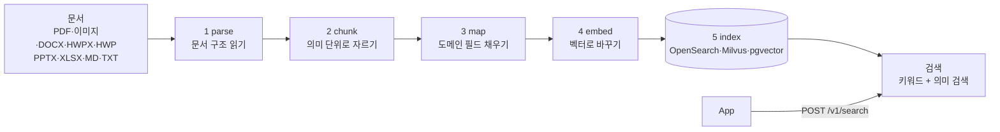
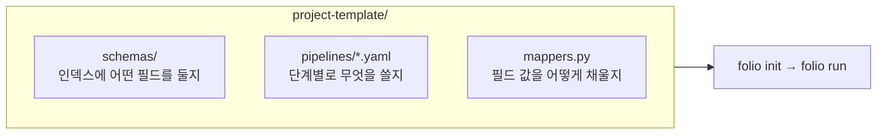
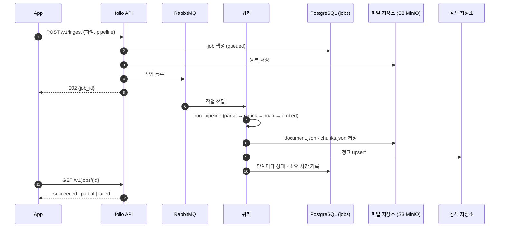
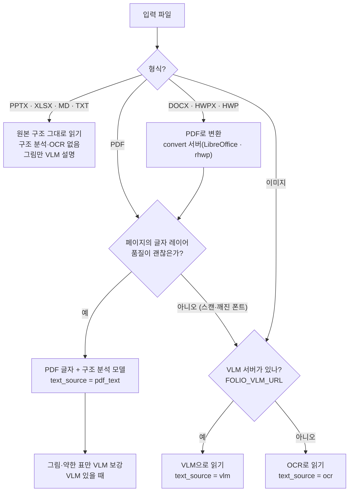
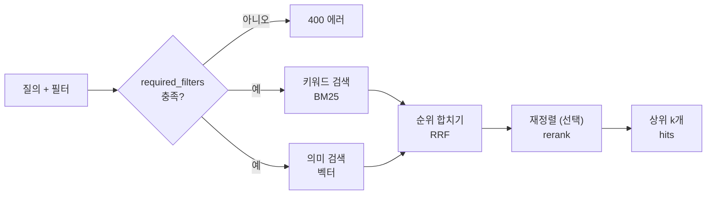
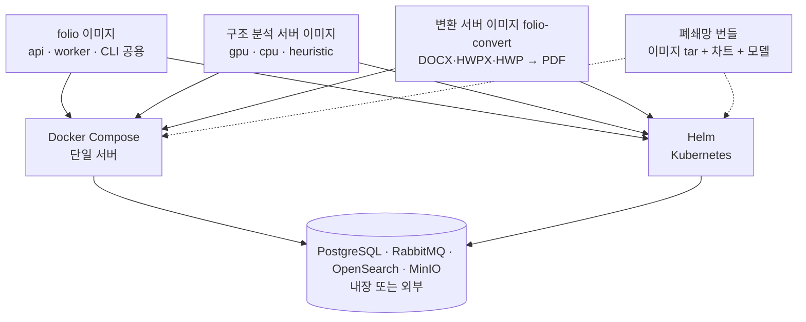

# folio

**문서를 넣으면 검색할 수 있는 인덱스를 만들고, 그 인덱스로 검색 API를 제공한다.**

- **고객사 구축은 파일 3개로 끝난다**: 스키마 파일, 파이프라인 YAML, 매퍼 함수
- **빠르다**: 디지털 PDF는 PDF 안의 글자를 그대로 쓰고, 스캔 페이지·그림만 VLM이나 OCR로 처리한다
- **다시 처리할 때 싸다**: 중간 결과를 저장해 두므로, 매핑이 바뀌어도 파싱·OCR을 다시 하지 않는다
- **어디서든 같은 코드로 돈다**: API 워커, Airflow, 노트북에서 같은 `run_pipeline`을 쓴다. Docker Compose와 Kubernetes에는 같은 이미지를 올린다

요구사항은 [PRD.md](PRD.md), 단계 함수 시그니처와 환경변수는 [docs/INTERFACES.md](docs/INTERFACES.md)에 있다.

## 한눈에 보기



| 단계 | 하는 일 | 결과물 |
| --- | --- | --- |
| parse | 페이지마다 제목·문단·표·그림을 찾아 위치와 함께 정리 | Document JSON |
| chunk | 섹션·표·목록을 깨지 않고 `max_tokens` 안에서 가장 크게 자름 | 청크 목록 |
| map | 고객사 매퍼 함수로 계약번호·당사자 같은 도메인 필드를 채움 | Chunk Record |
| embed | OpenAI 호환 임베딩 서버로 청크를 벡터로 변환 | `embedding` 필드 |
| index | 검색 저장소(Sink)에 저장. 같은 문서를 다시 넣으면 이전 청크를 교체 | 검색 인덱스 |

단계 사이에서 주고받는 데이터 형식(Document JSON, Chunk Record, Sink)만 고정돼 있다([PRD 계약 명세](PRD.md#계약-명세)). 그래서 어느 단계든 `module:function` 하나로 바꿀 수 있다. 상속이나 플러그인 등록은 필요 없다.

## 구축은 파일 3개



| 파일 | 정하는 것 | 예 |
| --- | --- | --- |
| `schemas/opensearch/contracts.json` | 인덱스 필드와 타입 | `contract_no: keyword` |
| `pipelines/contracts.yaml` | 단계별 함수·옵션, 저장소, 검색 튜닝 | `chunk.max_tokens: 1024` |
| `mappers.py` | 청크마다 도메인 필드 값 | `map_contract(doc, chunk) -> dict` |

## 적재 흐름 (API)

App이 파일을 올리면 API는 바로 `job_id`를 돌려주고, 실제 처리는 워커가 한다.



Airflow에서는 예시 DAG(`project-template/dags/folio_ingest.py`)가 folio 이미지로 `folio run`을 실행한다. Airflow 쪽에 folio를 설치할 필요가 없다.

## 파싱: 페이지마다 가장 싼 방법을 고른다



- **구조 분석 모델**: 페이지에서 제목·문단·표 영역을 찾는 모델. 기본은 PP-StructureV3 GPU 서버다. GPU가 없으면 CPU 버전(약 40배 느림, 메모리 약 12 GB), 개발·CI는 모델 없는 `heuristic`을 쓴다. 라이브러리 단독 사용 시 `FOLIO_STRUCTURE_URL`이 없으면 `heuristic`이다.
- **DOCX·HWPX·HWP**: 기본은 PDF로 변환한 뒤 PDF 경로를 탄다(`docx_mode`·`hwpx_mode: convert`). 페이지 번호와 bbox가 생기지만, 그 좌표는 변환된 PDF 기준이다(`meta.convert.pdf_hash`). 변환은 `folio-convert` 서버(`FOLIO_CONVERT_URL`)가 맡고, URL이 없으면 로컬 LibreOffice·rhwp를 쓴다. DOCX는 LibreOffice, HWPX·HWP는 rhwp(실패 시 LibreOffice + H2Orestart)다. 선택 근거는 [DOCX](wiki/2026-10-21-docx-converter-benchmark.md)·[HWPX](wiki/2026-10-20-hwpx-converter-benchmark.md) 벤치마크에 있다. XML을 직접 읽는 `native` 모드(FR-21)는 아직 없다.
- **VLM**: `parse.vlm: auto`가 기본이다. `FOLIO_VLM_URL`이 없으면 VLM 대신 OCR을 쓴다. 운영용 VLM 모델은 아직 정하지 않았다(개발용 `folio vlm-stub`만 있음).
- **청킹**: 기본 `adaptive`. 대안은 `page`, `fixed`.

## 검색 흐름



- **모드**: `hybrid`(기본, 둘 다), `bm25`(키워드만), `vector`(의미만)
- **필터**: 값이 하나면 같음, 목록이면 하나라도 일치, `{gte, gt, lte, lt}`면 범위(숫자, ISO 날짜)
- **필수 필터**: YAML `required_filters: [tenant_id]`를 두면 빠진 요청을 막는다. API에는 인증이 없으므로 내부망에 두고, App 백엔드가 사용자 권한으로 `tenant_id`·`acl`을 채워 호출한다
- 검색 튜닝을 바꿔도 App 코드는 그대로다. YAML `retrieval:`만 고친다

## 재처리: 바뀐 단계부터만 다시

각 단계 결과를 저장해 두므로, 바뀐 단계부터 다시 돌린다.


```bash
folio schema apply [--reindex]                   # 필드 추가 → mapping 갱신, 타입 변경 → 새 인덱스 + alias 교체(무중단)
folio reprocess --from map --index contracts     # 저장된 청크 재사용, 파싱·OCR 호출 0회
```

## 배포: 같은 이미지, 두 가지 방식



| 방식 | 명령 | 비고 |
| --- | --- | --- |
| Docker Compose | `cd deploy/compose && cp .env.example .env && docker compose up -d` | 프로필: `infra` + `gpu`(기본) \| `cpu` \| `dev` |
| Kubernetes | `helm install folio deploy/helm/folio -f values-dev.yaml` | GPU 없으면 `values-cpu.yaml` |
| 폐쇄망 | `deploy/bundle/make_bundle.sh` → `install.sh` | 인터넷 없이 Compose·Helm 설치 |
| Airflow(개발) | `.env`의 `COMPOSE_PROFILES`에 `airflow` 추가 | `POSTGRES_AIRFLOW_PASSWORD`·`DOCKER_GID`·`FOLIO_DOCKER_NETWORK` 설정, UI `localhost:8081`, 메타데이터는 내장 postgres의 `airflow` DB |
| Airflow(운영) | 공식 Apache Airflow Helm 차트 | `deploy/airflow/values-official-chart.yaml` + `rbac-folio-namespace.yaml`, folio 내장 PostgreSQL 공유 가능(`infra.postgres.extraDatabases`). [가이드](deploy/airflow/README.md) |

자세한 내용은 [deploy/README.md](deploy/README.md)에 있다.

## 빠른 시작 (로컬)

```bash
pip install -e ".[all]"                          # 라이브러리 + 서비스 + 모든 Sink + S3

cp -r project-template myproject && cd myproject
export OPENSEARCH_URL=http://localhost:9200 FOLIO_EMBED_URL=http://localhost:8001/v1
folio embed-stub &                               # 개발용 임베딩 서버 (운영은 실제 엔드포인트)
folio init                                       # 저장소·jobs 테이블·인덱스 생성 (여러 번 실행해도 안전)
folio run ./samples/ --pipeline contracts        # 파일당 JSON 결과 한 줄
```

노트북에서는 라이브러리만(`pip install -e .`) 설치해도 된다.

```python
from folio.contracts import load_config
from folio.pipeline import run_pipeline, search

cfg = load_config("pipelines/contracts.yaml")
result = run_pipeline("contract.pdf", cfg)
hits = search(cfg, "위약금 조항", filters={"tenant_id": "acme", "article": {"gte": 3}})
```

<details>
<summary><b>설치 옵션 전체</b></summary>

```bash
pip install -e ".[all]"          # 라이브러리 + 서비스 + 모든 Sink + S3
pip install -e ".[ocr]"          # heuristic 백엔드용 OCR(rapidocr)
pip install -e ".[docling]"      # 또는 ".[ppstructure]": 프로세스 내 구조 분석 백엔드
pip install -e ".[dev]"          # 테스트
```

</details>

<details>
<summary><b>파이프라인 YAML 전체 예시</b></summary>

```yaml
parse: {fn: folio.parse:default, backend: auto, vlm: auto, ocr_fallback: true, dpi: 144}
chunk: {fn: folio.chunk:adaptive, max_tokens: 1024, min_tokens: 128}   # 또는 folio.chunk:page|fixed
map:   mappers:map_contract               # 생략하면 공통 필드만 채운다
embed: {fn: folio.embed:http, batch_size: 64}
sink:  {type: opensearch, index: contracts}
retrieval:                                # 생략하면 hybrid, k=10, content만 BM25
  mode: hybrid                            # hybrid | bm25 | vector
  k: 10
  fields: {content: 1, contract_no: 3, party: 2}   # BM25 필드 가중치 (OpenSearch만)
  rrf_k: 60
  candidates: 50                          # 단계별 후보 수 (기본 max(k*3, 30)), rerank 입력
  rerank: {fn: folio.retrieval.rerank:http_rerank, top_n: 10}   # 선택, FOLIO_RERANK_URL
  required_filters: [tenant_id]           # 없으면 검색 요청 400
storage: ${FOLIO_STORAGE_URI:-.folio/artifacts}
```

검색 로직 전체를 바꾸려면 `retrieval.fn: module:factory`를 지정한다(`factory(sink, embed, **settings)`).

</details>

<details>
<summary><b>API · 실행 모드 · 평가</b></summary>

| 엔드포인트 | 설명 |
| --- | --- |
| `POST /v1/ingest` | multipart `file`, `pipeline` → `202 {job_id}` |
| `GET /v1/jobs/{id}` | `queued` \| `running` \| `succeeded` \| `partial` \| `failed`, 단계별 상태·소요 시간, 에러 메시지 |
| `POST /v1/search` | JSON `query`, `pipeline`, `k`(≤100), `mode`, `filters` → `{pipeline, hits: [{chunk_id, doc_id, score, content, record}]}`. 잘못된 필터·모드, 필수 필터 누락은 400 |
| `DELETE /v1/documents/{doc_id}?pipeline=` | 인덱스의 청크와 저장된 중간 결과 삭제 |
| `/healthz`, `/readyz` | 상태 확인 |

`folio` 이미지 실행 모드: `folio api` / `folio worker` / `folio init` / `folio structure-server` / `folio embed-stub` / `folio vlm-stub`. 변환 서버는 별도 이미지 `folio-convert`(`folio convert-server`, :9100)다.

평가(Recall@k·MRR·nDCG):

```bash
folio eval testset --pipeline contracts --n 50 && folio eval run --pipeline contracts --testset testset.json
```

</details>

## 현재 상태 (2026-10-21)

| 영역 | 상태 |
| --- | --- |
| 입력 형식 | ✅ PDF, 이미지(PNG·JPG·TIFF·BMP·WebP), PPTX, XLSX, Markdown, TXT(UTF-8·CP949 자동 판별) |
| DOCX·HWPX·HWP | ✅ `convert` 모드(PDF 변환 후 파싱, FR-20) ([작업 기록](wiki/2026-10-21-docx-hwpx-convert-mode.md)). ⏸️ `native` 모드(FR-21) 보류. PPTX도 `pptx_mode="convert"`로 같은 변환 서버를 쓸 수 있다(픽스처로 확인, 기본은 `native`). 한국어 어절은 공백 글리프가 없어도 글자 간격으로 나눈다 |
| VLM | 🟡 연동 완료, 운영 모델 미정(개발용 stub만 있음) |
| 검색 API | ✅ `POST /v1/search` + YAML `retrieval:` ([작업 기록](wiki/2026-10-20-implementation-search-api.md)) |
| 구조 분석 | ✅ 기본 PP-StructureV3 GPU ([작업 기록](wiki/2026-10-21-ppstructure-gpu-default.md)) |
| Airflow | ✅ 예시 DAG(DockerOperator 기본, KubernetesPodOperator 선택) ([작업 기록](wiki/2026-10-20-airflow-container-dag.md)) |

검증한 것: 단위 테스트, Sink 통합 테스트(OpenSearch·Milvus·pgvector), Compose E2E(전 형식, VLM stub 포함, DOCX·HWPX 변환 서버 경로), Compose Airflow DAG E2E, k3s 공식 Airflow 차트 + KubernetesPodOperator, kind + Helm E2E(업그레이드·워커 강제 종료 포함), 오프라인 번들 설치. 상세는 [코어 파이프라인](wiki/2026-10-20-implementation-core-pipeline.md), [형식·VLM·adaptive 청킹](wiki/2026-10-20-implementation-formats-vlm-adaptive.md) 작업 기록에 있다.

## 테스트

```bash
pytest -q                                              # 단위 테스트 (모델·외부 서비스 불필요)
pytest -q -m integration tests/integration/test_sinks_integration.py   # OpenSearch·pgvector·Milvus 컨테이너 기동
deploy/compose/e2e.sh                                  # Compose E2E (적재 → 검색)
AIRFLOW=1 deploy/compose/e2e.sh                        # + Airflow DAG(DockerOperator) 실행·인덱스 적재 확인
deploy/kind/e2e.sh                                     # kind + Helm E2E (업그레이드 포함)
python scripts/bench_backends.py --backends heuristic,docling,ppstructure   # 구조 분석 백엔드 벤치마크
```

## 폴더 구조

```
folio/             라이브러리: contracts, parse, backends, chunk, embed, map, sinks, retrieval, eval, storage, pipeline, cli
service/           API(FastAPI) + 워커(Celery)
project-template/  고객사 구축 템플릿: schemas/ pipelines/ mappers.py dags/ samples/
deploy/            docker, compose, helm, bundle, kind, airflow
tests/             단위, 통합, fixtures (생성 스크립트: tests/fixtures/make_fixtures.py)
```

## 용어

| 용어 | 뜻 |
| --- | --- |
| Document JSON | parse 결과. 페이지별 블록(제목·문단·표·그림)과 위치, 글자 출처(`pdf_text`·`ocr`·`native`·`vlm`) |
| Chunk Record | 검색 저장소에 들어가는 한 행. `content`, `embedding`, 페이지, 섹션 경로 + 도메인 필드 |
| Sink | 검색 저장소 어댑터. `upsert`·`delete` 두 함수만 있다 |
| 구조 분석 백엔드 | 페이지 이미지에서 제목·문단·표 영역을 찾는 모델(PP-StructureV3, Docling, heuristic) |
| VLM | 이미지를 보고 글로 설명하는 모델. 스캔 페이지 읽기, 그림 설명, 복잡한 표에 쓴다 |
| BM25 | 단어가 얼마나 겹치는지로 매기는 키워드 검색 점수 |
| RRF | 여러 검색 결과의 순위를 하나로 합치는 방법 |
| rerank | 후보를 별도 모델로 다시 정렬해 정확도를 높이는 단계 |
