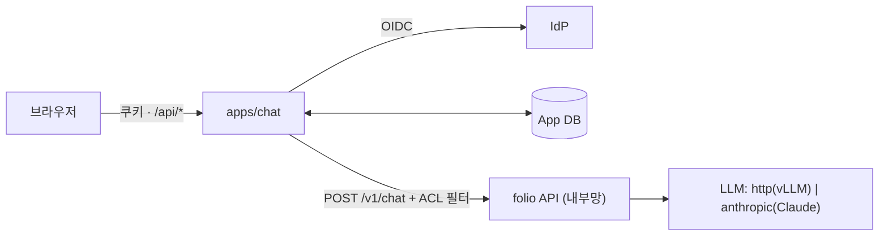

# 참조 채팅 App 구현

## 요청과 결정

- 작업 기준: 원격 저장소가 없어서 로컬 `dev`(generation merge `464173f`)에서 `feat/chat-ui` worktree를 만들어 작업하고 로컬 `dev`에 merge했다. push는 하지 않았다.
- 사용자 요청: RAG용 기본 Chat UI → 멀티턴 → SSO 연동과 대화 메시지 CRUD 백엔드를 포함한 기본 App. generation 세션과 협의해서 진행.
- 결정(사용자): LLM은 우선 Claude API, 나중에 pgx spark의 vLLM으로 교체. 멀티턴 지원. 스트리밍은 우선 하지 않음.
- 결정(사용자): UI는 generation 세션이 만든 `POST /v1/chat` 위에 얹는다. 백엔드 로직(재작성·프롬프트·인용)은 중복으로 만들지 않는다.
- generation 세션(folio-c1)과 합의한 내용:
  - `/v1/chat` 계약을 고정한다. 바꾸거나 스트리밍을 추가하면 먼저 알린다.
  - Claude 어댑터는 이 브랜치의 것을 쓴다.
  - 새 FR 번호는 FR-32로 한다.
  - Dockerfile은 바꾸지 않는다.
- 설계 결정:
  - App은 `folio`를 import하지 않고 HTTP로만 호출한다. folio API는 인증이 없으므로 내부망에 두고, 사용자는 App에만 접속한다.
  - 처음에 folio 서비스의 `GET /chat`으로 만들었던 무상태 UI는 App UI로 옮기고 제거했다. UI가 두 개가 되는 중복을 피하고, 인증 없는 API에 페이지를 붙이지 않기 위해서다.
  - 권한 필터는 로그인 시 토큰 클레임에서 정하고(`FOLIO_APP_ACL_CLAIMS`), 클라이언트가 보낸 같은 키를 덮어쓴다. 매핑된 클레임이 없는 사용자는 403을 받는다. folio는 `None` 필터를 버리기 때문에, 막지 않으면 검색 범위가 넓어진다.
  - 성공한 턴만 질문과 답변을 함께 저장한다. 실패하면 아무것도 저장하지 않고, UI가 같은 질문을 다시 보낼 수 있게 한다.
  - 인증 모드 기본값은 `oidc`다. 설정을 빠뜨리면 로그인 없이 모두가 한 사용자로 열리는 일을 막기 위해서다(fail closed). `dev`는 명시해야 켜진다.
  - 검색 결과 `record`의 `embedding`은 저장 전에 제거한다. Sink에 따라 벡터가 섞여 올 수 있기 때문이다.
  - 메시지의 "수정"은 지원하지 않는다. 지난 질문을 고치면 이후 답변의 근거가 틀어지기 때문이다. 대신 "이 질문부터 삭제"(이후 메시지 함께 삭제)와 답변 피드백을 둔다.

## 구성

- `apps/chat/settings.py`: 환경변수(`FOLIO_APP_*`, `OIDC_*`, `FOLIO_API_URL`).
- `apps/chat/auth.py`: Authlib OIDC 코드 플로(PKCE S256, ID 토큰 서명·nonce 검증)와 `dev` 모드. 세션은 서명 쿠키(`folio_chat`, HttpOnly, SameSite=Lax, 12시간)이고, `{sub, email, name, acl}`을 담는다.
- `apps/chat/store.py`: SQLAlchemy Core로 `chat_users`, `chat_conversations`, `chat_messages` 테이블을 둔다. 모든 조회·변경은 `user_id`로 범위를 좁힌다.
- `apps/chat/main.py`: `create_app(transport=None)` 팩토리와 `/api/*` 엔드포인트. folio 오류는 400·422 → 400, 502 → 502, 나머지와 연결 실패 → 503으로 바꾼다. 시각은 UTC ISO 형식이다.
- `apps/chat/static/index.html`: 대화 목록, 근거 패널, 피드백, 설정을 갖춘 UI다. 외부 리소스를 쓰지 않고, URL은 모두 상대 경로라서 경로 접두사가 붙은 프록시 뒤에서도 동작한다. 401을 받으면 `auth/login`으로 이동한다.
- `folio/generation/anthropic.py`: `generation.chat`에 쓰는 Claude 단계. 기본 모델은 `claude-opus-5-5`다.
  - `system` 턴은 최상위 `system`으로 옮긴다.
  - `fallbacks="default"`(beta `server-side-fallback-2026-07-01`)를 기본으로 켠다. Claude API 전용이라 프록시나 다른 플랫폼에서는 `fallbacks: false`로 끈다.
  - 응답이 refusal이면 예외를 낸다.
  - extra는 `folio[anthropic]`이다.
- `pyproject.toml`: extra `app`과 `anthropic`을 추가했고, `dev`에 둘을 포함했다. wheel 패키지에 `apps`를 추가했다.

## 검증 결과

| 항목 | 방법 | 결과 |
| --- | --- | --- |
| 전체 단위 테스트 | `pytest -q` | 155 passed, 1 skipped |
| 실제 folio와 연동 | `test_against_real_folio_chat`: App을 folio의 실제 `service.api` `/v1/chat`(memory sink, stub chat 단계, `required_filters: [tenant_id]`)에 연결 | 201과 인용-근거 일치, 로그인 ACL `t1`로 검색(클라이언트 `other` 무시), `generation:` 없는 파이프라인은 400, `embedding` 제거 |
| UI 동작(실제 App 백엔드) | dev 모드 App과 실패 스위치가 있는 가짜 folio, Playwright | 피드백 저장, 이 질문부터 삭제(6개 → 2개), 502 시 저장 0건과 재시도 버튼, 재시도 후 저장, 이름 변경, 대화 삭제, page error 0 |
| App API | `tests/test_chat_app.py`(9개): CRUD, 멀티턴 이력, 실패 시 미저장(502·400·500·연결 실패), 50개 상한, 파이프라인 허용 목록, OIDC 콜백(가짜 IdP 객체), 사용자 간 격리(모든 엔드포인트 404), ACL 덮어쓰기, 클레임 없음 403, 비밀키 없으면 기동 실패 | 통과 |
| Claude 단계 | `tests/test_generation_anthropic.py`(3개): 실제 SDK에 가짜 HTTP 전송 계층을 붙여 요청 본문·헤더(`system`, `output_config.effort`, `fallbacks`, beta 헤더), 응답 텍스트, refusal 예외 확인 | 통과 |
| 실제 OIDC 흐름 | 로컬 테스트용 OIDC 서버(RS256 ID 토큰, PKCE 검사, 직접 작성)와 uvicorn 위의 App, 가짜 folio로 리다이렉트 흐름 실행 | 로그인 전 401, 로그인 후 `/api/me` 정상, 클라이언트 `tenant_id=t-b` → folio에는 `t-a`, 로그아웃 후 401 |
| 브라우저 E2E | Playwright(Chromium)로 SSO → 질문 2턴 → 인용 클릭 → 새로고침 | 대화 목록·답변 2개 복원, 쿠키 HttpOnly·SameSite=Lax, page error 0 |
| UI 단독 | sub-agent가 Playwright로 가짜 API에 대해 40개 항목 점검 | 39개 통과. 남은 1개는 일부러 만든 401·502 응답이 콘솔 오류로 잡힌 것이고, `pageerror`는 0 |
| 버그 수정 | E2E에서 방금 만든 대화가 "어제"로 표시됨 | SQLite가 시간대 정보 없는 시각을 돌려준 탓. UTC로 명시해 해결했고, 테스트로 `+00:00`을 확인 |

## 검증하지 않은 것

- **실제 Claude 호출**: 이 환경에는 `ANTHROPIC_API_KEY`가 없고 `ant` CLI도 설치되어 있지 않다. 요청 형식만 가짜 전송 계층으로 확인했다.
- **실제 IdP**: Keycloak, Entra ID 등과의 연동은 확인하지 않았다. RP-initiated logout도 없어서, 로그아웃은 App 세션만 지운다(IdP 세션은 남는다).
- **실제 검색 저장소와 LLM을 붙인 E2E**: folio `/v1/chat`은 실제 코드로 확인했지만, 검색 저장소(OpenSearch 등)와 LLM은 테스트용 대체물(memory sink, stub chat 단계)을 썼다.
- **배포**: Docker 이미지, Compose, Helm에는 넣지 않았다. 현재 Dockerfile의 extras 목록에 `app`과 `anthropic`이 없다.
- **PostgreSQL에서의 동작**: SQLite로만 실행했다. 외래 키는 PostgreSQL에서만 강제된다.

## 남은 작업

- pgx spark vLLM이 준비되면 `generation.chat`을 `folio.generation:http`로 바꾸고 실제 질의로 확인한다.
- 실제 IdP로 확인한다(Keycloak 컨테이너는 pgx spark에서 띄운다). RP-initiated logout을 붙일지 정한다.
- Compose·Helm에 `chat` 서비스를 넣을지 정한다(이미지 extras 변경이 필요하다).
- 스트리밍: `/v1/chat`에 SSE가 생기면 App도 그대로 전달하게 바꾼다(folio-c1과 합의).
- 대화 보존 기간·감사 로그·관리자 조회는 범위 밖이다.
